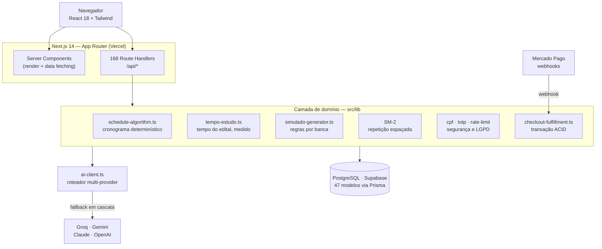
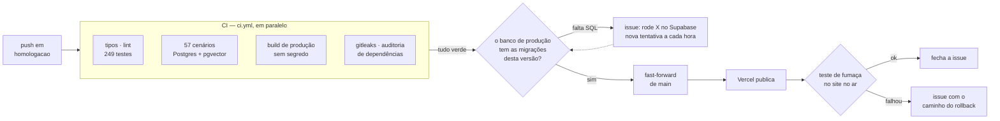

# GabaritAI

Plataforma SaaS de preparação para concursos públicos. Aplicação Next.js 14 fullstack em produção, com **173 endpoints de API**, banco PostgreSQL de **50 modelos** e orquestração de múltiplos provedores de LLM.

**No ar:** [gabaritai-red.vercel.app](https://gabaritai-red.vercel.app)

**Para ler em 2 minutos** — os pontos com mais engenharia:

- **Quanto tempo o edital pede, medido no banco.** Escolha o concurso e as suas horas: o tempo sai do conteúdo cadastrado — palavras de cada material, questões ativas, a mediana real do tempo dos alunos por questão — e a resposta diz quanto dela é dado medido. A mesma conta vale na home e no cronograma. → [seção 8](#8-quanto-tempo-o-edital-pede-medido-no-banco)
- **Pagamento que não perde nem duplica dinheiro.** Notificação repetida, fora de ordem ou perdida; três avisos simultâneos liberam o acesso uma vez só — provado contra PostgreSQL real. → [seção 4](#4-pagamento-três-camadas-de-defesa-contra-o-dinheiro-sumir)
- **IA com as contas fora do modelo.** RAG que só busca no edital do aluno e mostra as fontes; um agente que não escolhe de quem são os dados. → [seção 7](#7-ia-rag-com-escopo-agente-com-ferramentas-cronograma-adaptativo)
- **CI/CD com trava de banco.** Todo push passa por tipos, lint, 249 testes unitários, 57 cenários contra Postgres real, build sem segredo, caça a chaves vazadas e auditoria de dependências. A promoção para produção é automática, mas espera o SQL da versão estar aplicado e termina com teste de fumaça contra o site no ar. → [CI/CD](#cicd-do-commit-à-produção)
- **Provas oficiais refeitas com o tempo do edital.** 20 provas (2.160 itens) da PF, PRF, PCDF, PMDF e PMGO extraídas dos PDFs de quatro bancas e conferidas contra o gabarito definitivo, cronômetro com o prazo guardado no servidor, correção com a regra de cada banca e histórico de cada tentativa. → [seção 10](#10-provas-oficiais-anteriores-refeitas-com-o-tempo-do-edital)
- **Banco de questões que não espera.** Função na mesma região do banco, paginação por cursor de chave, pré-busca e explicação da IA gerada uma vez para todos. → [seção 9](#9-banco-de-questões-que-responde-sem-esperar)
- **Auditoria por classe de bug.** Achada uma senha com valor padrão, a busca foi pelo padrão — e virou um teste que impede a volta. → [seção 6](#6-segredo-ausente-é-erro-nunca-valor-padrão)
- **Conteúdo pago trancado no servidor.** A conta gratuita usa a calculadora e o cronograma; material, provas e IA ficam atrás de uma trava por rota — nove rotas abertas achadas e fechadas, com teste que confere até que nenhuma chamada à IA sai de conta gratuita. → [seção 11](#11-conteúdo-pago-trancado-no-servidor-não-na-tela)

---

## O problema

Quem estuda para concurso de alta concorrência enfrenta quatro coisas que nenhuma planilha resolve: não saber **o que** estudar (editais com pesos diferentes por banca), não saber **se dá tempo** de cobrir o edital até a prova, não saber **quando revisar** (a curva do esquecimento não espera), e não ter **diagnóstico real** do próprio desempenho por matéria.

O GabaritAI ataca os quatro com uma divisão de trabalho deliberada: **algoritmo determinístico onde é preciso rigor** — cronograma, estimativa de tempo, repetição espaçada, prioridade de estudo —, porque um prompt pedindo "monte um cronograma" alucina datas e não dá a mesma resposta duas vezes; e **IA onde é preciso linguagem** — tirar dúvida e montar o diagnóstico —, sempre presa ao material do curso e aos dados do aluno.

---

## Arquitetura



Não há `middleware.ts`: a sessão é verificada dentro de cada rota com `getUserFromRequest`/`verifyToken` (`src/lib/auth-server.ts`, `src/lib/jwt.ts`). É mais verboso que um middleware global, mas deixa explícito em cada endpoint quem pode chamá-lo.

**Por que Next.js App Router e não um backend separado?** O projeto chegou a ter um serviço NestJS (`apps/api`, ~1.9k linhas), mas o caminho de produção ficou nos Route Handlers do Next. Motivo prático: com um único deploy na Vercel, Server Components leem o banco direto sem round-trip HTTP, e as rotas `/api/*` cobrem o que precisa de contrato REST (webhooks, cron, cliente mobile futuro). Para um time de uma pessoa, a separação em dois deploys custava mais do que entregava.

---

## Decisões técnicas que valem explicação

### 1. Cronograma determinístico, não gerado por LLM

[`src/lib/schedule-algorithm.ts`](src/lib/schedule-algorithm.ts) · 323 linhas · o método em [`src/lib/metodo-estudo.ts`](src/lib/metodo-estudo.ts)

LLM erra data, inventa carga horária e custa dinheiro a cada regeração. O algoritmo aqui é aritmética pura e **reprodutível** — mesma entrada, mesma saída, sempre:

1. Conta os dias entre hoje e a prova, filtrando só os dias da semana que o aluno marcou como disponíveis.
2. Converte as horas/dia em **pomodoros** (25 min de foco, 5 de pausa, 15 a cada 4 blocos): 3 h rendem 5 pomodoros = 125 min de foco → `totalMinAvailable`.
3. Soma o tempo que o **conteúdo** de cada matéria pede, medido no banco ([seção 8](#8-quanto-tempo-o-edital-pede-medido-no-banco)) → `totalMinRecommended`. Antes eram 60 h fixas por matéria.
4. Distribui as matérias em **round-robin ponderado** pelo peso da banca, em blocos de 25 min de estudo novo e de questões. Cada sessão de estudo agenda **revisões espaçadas** da matéria 1, 7, 15 e 30 dias depois (20%, 10%, 7% e 5% do tempo estudado — a curva do esquecimento de Ebbinghaus e o efeito de espaçamento de Cepeda et al., 2008); as revisões vencidas abrem o dia, até metade dele, e o que não cabe passa para o dia seguinte.
5. Se `recomendado > disponível`, devolve `isFeasible: false` com o déficit em minutos — o aluno descobre **antes** que não vai dar tempo, e ajusta.

### 2. Repetição espaçada SM-2

[`src/app/api/me/flashcards/[id]/review/route.ts`](src/app/api/me/flashcards/[id]/review/route.ts)

O mesmo algoritmo do Anki. O aluno nota a resposta de 0 a 5 e o intervalo até a próxima revisão se ajusta pelo *ease factor*:

```
EF' = max(1.3, EF + (0.1 − (5−q) × (0.08 + (5−q) × 0.02)))
```

Nota < 3 reseta o intervalo para 1 dia. Nota ≥ 3 multiplica o intervalo anterior pelo EF.

Dois detalhes que não são óbvios:
- **IDOR.** O endpoint recebe um `id` na URL. Antes de qualquer escrita, ele confere se o flashcard pertence ao usuário autenticado ou é público. Sem essa checagem, trocar o id na URL deixaria qualquer aluno ler e sobrescrever o progresso de outro.
- **Concorrência.** `upsert` sobre a constraint composta `@@unique([userId, flashcardId])` — duas revisões simultâneas do mesmo card não criam registro duplicado.

### 3. Roteador de LLM com fallback em cascata

[`src/lib/ai-client.ts`](src/lib/ai-client.ts) · 230 linhas

Depender de um provedor só significa herdar o downtime e o rate limit dele. E usar um modelo caro para extrair texto de uma questão é desperdício. A fila muda conforme a natureza da tarefa:

| Tipo de tarefa | Ordem de tentativa |
|---|---|
| Extração mecânica | Groq → Gemini Flash → OpenAI → Claude |
| Geração de conteúdo | Gemini Flash → Claude → OpenAI → Groq |
| Correção de redação | Claude → OpenAI → Gemini → Groq |

Cada provedor que falha (erro, timeout, cota) cai para o próximo sem o usuário perceber.

Junto vem `parseAIJson`, que existe porque **modelo de linguagem não respeita contrato de saída**: às vezes devolve o JSON embrulhado em ```` ```json ````, às vezes precedido de "Claro! Aqui está:". A função limpa a marcação, e se o `JSON.parse` ainda falhar, extrai o primeiro `{...}` ou `[...]` por regex antes de desistir com erro rastreável.

### 4. Pagamento: três camadas de defesa contra o dinheiro sumir

[`src/lib/checkout-fulfillment.ts`](src/lib/checkout-fulfillment.ts) · [`src/lib/payment-sync.ts`](src/lib/payment-sync.ts) · [`src/lib/mercadopago.ts`](src/lib/mercadopago.ts)

O pior bug possível de um SaaS é **dinheiro cobrado, acesso não liberado** — e ele tem mais de uma causa. Cada uma pede uma defesa diferente.

**Atomicidade.** Quando o pagamento é confirmado, cinco escritas precisam acontecer ou nenhuma: atualizar o plano, matricular nos cursos, incrementar vendas, registrar o cupom e gravar auditoria. Tudo num `prisma.$transaction`. Um erro no meio não pode deixar o aluno pago e sem acesso.

**Idempotência, em dois níveis.** O Mercado Pago reenvia webhook — por retry, por timeout, por evento duplicado. A liberação é **reivindicada** com um `UPDATE ... WHERE fulfilledAt IS NULL` que devolve quantas linhas mudou: só um processo consegue, e quem decide é o Postgres, não a ordem de chegada. A versão anterior lia `paidAt` e depois decidia — uma janela de *time-of-check to time-of-use* por onde dois webhooks simultâneos passavam. O teste de integração dispara três notificações com `Promise.all` contra um Postgres real e confere que a venda conta uma vez. No outro extremo do fluxo, uma cobrança PIX pendente é reaproveitada em vez de gerar outra. Uma camada evita **liberar** duas vezes; a outra evita **cobrar** duas vezes.

**Três caminhos de confirmação, uma regra.** O webhook é o caminho normal, mas pode se perder. A tela de PIX consulta a API a cada 4 s — mas só com a aba aberta. E um cron diário ([`reconciliar-pagamentos`](src/app/api/cron/reconciliar-pagamentos/route.ts)) pergunta ao MP o estado de todo pagamento pendente dos últimos 3 dias, cobrindo o caso em que os outros dois falham juntos. Os três chamam a mesma função ([`applyMpPaymentToLocal`](src/lib/payment-sync.ts)) — a regra é escrita uma vez, e não em três implementações que divergem com o tempo. E o webhook distingue erro temporário de permanente: API do MP fora do ar devolve 503 (o MP reenvia), pagamento inexistente devolve 200 (reenviar não adianta).

**Status só anda pra frente.** O Mercado Pago manda várias notificações do mesmo pagamento, às vezes simultâneas, e cada uma consulta a API deles. Duas consultas paralelas podem voltar em ordem trocada — a que perguntou um instante antes da aprovação responde "pending" depois da que respondeu "approved", e sobrescreve. Isso aconteceu de verdade num pagamento real. A defesa não é ordenar as notificações (não há como), é tornar a escrita monotônica: [`transicaoPermitida`](src/lib/payment-status.ts) dá um nível a cada status e só aceita troca para nível igual ou maior. Notificação atrasada vira no-op; `APPROVED` só sai para `REFUNDED`.

Junto: validação HMAC-SHA256 da assinatura do webhook com janela anti-replay de 5 minutos, e checagem de valor divergente que rejeita o pagamento se o valor aprovado não bate com o cobrado.

Um detalhe de interface que também é correção de bug: `/api/checkout/status` devolve **por que** não confirmou (`sincronizado`, `erro_mp:…`, `sem_provider_payment_id`), em vez de só devolver que não confirmou. Antes, uma falha de rede e um PIX legitimamente pendente apareciam idênticos para o usuário — um erro disfarçado de estado normal é um erro que ninguém reporta.

### 5. Dados pessoais sob LGPD

[`src/lib/cpf.ts`](src/lib/cpf.ts) · [`src/lib/totp.ts`](src/lib/totp.ts) · [`src/lib/rate-limit.ts`](src/lib/rate-limit.ts)

O CPF é gravado em **duas colunas com funções diferentes**, e a razão é que uma só não resolve:

- `cpfHash` — SHA-256 com salt. Determinístico, então aceita índice `@unique` e responde "esse CPF já existe?" em O(1). Irreversível.
- `cpfEncrypted` — AES-256-GCM, IV aleatório de 12 bytes, authentication tag. Reversível só sob necessidade fiscal. GCM e não CBC porque é autenticado: detecta adulteração do payload no banco, não só protege o sigilo.

Hash sozinho não permitiria devolver o dado ao titular; criptografia sozinha não permitiria checar unicidade sem decifrar a base inteira.

Também aqui: **2FA TOTP (RFC 6238)** implementado com o `crypto` nativo do Node — decode Base32, HMAC-SHA1 do contador de 8 bytes, truncamento dinâmico, módulo 10⁶, tolerância de ±1 janela para clock drift. E **rate limiting** em janela deslizante por `identifier:ip`: 5 tentativas em 15 min, lockout de 30 min, com trilha em `login_attempts` e `audit_logs`.

### 6. Segredo ausente é erro, nunca valor padrão

[`src/lib/segredo.ts`](src/lib/segredo.ts) · [`src/lib/cron-auth.ts`](src/lib/cron-auth.ts) · [`src/lib/setup-auth.ts`](src/lib/setup-auth.ts)

O padrão `process.env.CHAVE ?? 'valor-de-desenvolvimento'` é comum e, num repositório público, perigoso: se a variável faltar em algum ambiente, o sistema não quebra — passa a operar com uma chave que qualquer pessoa lê no GitHub. Uma auditoria procurando essa classe de bug achou o padrão na chave de criptografia de CPF, nos salts de hash e no token dos crons.

A regra agora é uma só: fora de produção o fallback existe (para `next dev` funcionar sem configuração); em build de produção, incluindo previews, segredo ausente é erro explícito. Comparações de token usam `timingSafeEqual` sobre SHA-256, para não vazar o segredo pelo tempo de resposta.

Mesma auditoria, outro achado: o `/api/health` público fazia uma chamada real a cada provedor de IA por acesso. Abrir em loop esgotava a cota gratuita que atende os alunos. Hoje a versão pública só responde `{ ok, versao }` — o commit no ar — e o diagnóstico completo exige admin, com cache de 5 minutos.

### 7. IA: RAG com escopo, agente com ferramentas, cronograma adaptativo

[`src/lib/rag/`](src/lib/rag/) · [`src/lib/agente/`](src/lib/agente/) · [`src/lib/peso-adaptativo.ts`](src/lib/peso-adaptativo.ts)

**RAG no mentor.** O material dos cursos é fatiado por seção, transformado em vetores (Gemini, 1.536 dimensões) e guardado com **pgvector** no próprio Postgres, com índice HNSW. Cada pergunta busca os trechos mais próximos **só nas matérias do edital do aluno** — os materiais são compartilhados entre cursos, e sem esse filtro um aluno recebia trecho de matéria que a prova dele não cobra. A resposta mostra as fontes. pgvector em vez de um banco vetorial separado porque o vetor fica na mesma tabela que o resto: filtrar por matéria é um `WHERE`, não uma sincronização entre dois sistemas. Um cron diário indexa material novo; material sem texto ganha uma "lápide" que impede a fila de travar sobre ele.

**Agente de diagnóstico.** O modelo decide quais ferramentas chamar — desempenho por matéria, tópicos fracos, erros recentes, busca no material, dias até a prova — e entrega um plano validado. Três decisões de desenho:

- **A conta fica fora do modelo.** "Onde o aluno perde mais pontos" é uma função pura e testada (`fatia da prova × (1 − acerto suavizado)`); o modelo a chama e explica. LLM erra aritmética e não é reprodutível.
- **O modelo não escolhe de quem são os dados.** O id do aluno vem da sessão e fica preso no *closure* das ferramentas; nenhuma recebe id de usuário como argumento. Prompt injection não tem por onde alcançar outro aluno — o teste de integração planta um segundo aluno e confere que nada dele aparece.
- **O loop recebe o modelo injetado.** Nos testes, um modelo falso com respostas roteirizadas exercita erro de ferramenta, ferramenta inventada, JSON quebrado e teto de passos — sem rede, sem custo, reprodutível.

Formato OpenAI de *tool calling*, que Groq e Gemini também aceitam; como a API é sem estado, o fallback entre provedores acontece por chamada, no meio da conversa.

**Servidor MCP para o admin.** [`mcp/`](mcp/) expõe, pelo Model Context Protocol, quatro ferramentas de análise de conteúdo — cobertura do edital (matérias e tópicos sem questão), busca de questões, desempenho agregado da turma — para o admin usar conversando com o Claude. O protocolo está implementado direto (JSON-RPC sobre stdio: `initialize`, `tools/list`, `tools/call`, `ping`), sem SDK. Ferramenta de admin e não pública porque o banco de questões é o produto. Três camadas de proteção: as ferramentas só leem; nada devolve dado pessoal (desempenho agregado omite grupos com menos de 3 alunos); e o usuário do banco é um papel com `SELECT` em 10 tabelas, sem acesso a `users` nem `payments` — verificado contra um Postgres real.

**Cronograma adaptativo (opcional).** O algoritmo de cronograma não muda: antes dele, o peso de cada matéria é multiplicado por um fator de desempenho, limitado a [0,6; 1,6] para nenhuma matéria sumir. O acerto passa por **suavização bayesiana** — `(acertos + 0,7 × 10) / (tentativas + 10)` —, então errar 2 de 2 questões quase não mexe e errar 20 de 20 mexe: transição contínua, sem limiar arbitrário.

### 8. Quanto tempo o edital pede, medido no banco

[`src/lib/tempo-estudo.ts`](src/lib/tempo-estudo.ts) · [`src/lib/tempo-estudo-dados.ts`](src/lib/tempo-estudo-dados.ts) · `GET /api/tempo/concursos`

A pergunta que mais pesa na decisão do aluno — *dá tempo de estudar o edital até a prova?* — era respondida com um número fixo: 600 h para qualquer concurso na home, 60 h por matéria no cronograma. Agora o tempo sai do conteúdo cadastrado de cada edital:

| Parte | Conta | De onde vem |
|---|---|---|
| Teoria | palavras do material de cada tópico ÷ 120 por minuto | contadas no SQL, ignorando marcação |
| Questões | questões ativas × mediana do tempo por questão | tentativas reais dos alunos, entre 5 s e 15 min |
| Revisão | 42% da teoria: as quatro revisões espaçadas (1, 7, 15 e 30 dias) | a mesma constante do cronograma ([`metodo-estudo.ts`](src/lib/metodo-estudo.ts)) |

- **A árvore de tópicos conta uma vez.** Os tópicos são assunto → subassuntos. Assunto que só agrupa não ganha tempo próprio, e subassunto cujo assunto já tem texto está coberto pela leitura do pai. A primeira versão contava a lista plana; os números de produção mostraram o erro — no PF Agente, 54 dos 589 tópicos eram contados em dobro.
- **Medido ou estimado, sempre dito.** Tópico ainda sem material (e sem cobertura) herda a mediana dos tópicos medidos da matéria; matéria com poucas tentativas usa a mediana da plataforma. A resposta traz `percentualMedido` — quanto do total é dado real — para a estimativa não parecer mais certa do que é. Mediana, e não média, porque uma questão esquecida aberta por 14 minutos não pode puxar o tempo de todo mundo.
- **Uma régua só.** A calculadora pública e o "vai dar tempo?" do cronograma usam a mesma função e a mesma régua: as horas viram pomodoros, com as pausas contadas. Unificar expôs um bug antigo: o cronograma ignorava o edital ativo e montava o plano com a lista de matérias do curso.
- **Barato de servir.** Um número fixo de consultas agregadas — cinco, seja 1 edital ou 100 — calcula todos os concursos de uma vez, sem uma consulta por edital; a CDN guarda a resposta por 1 hora e a função por 10 minutos (quem fura o cache da CDN com `?x=` recebe a mesma resposta, sem o banco recalcular); a conta com as horas do aluno roda no navegador — elas nem chegam ao servidor.

Os testes cobrem propriedades — mais palavras nunca reduz o tempo; as horas sugeridas sempre bastam e meia hora a menos nunca basta — e, contra um Postgres real, tudo o que engana a contagem: markdown, rascunho mais novo que o publicado, resumo, material rejeitado, tópico arquivado, questão anulada, tempo absurdo.

### 9. Banco de questões que responde sem esperar

[`src/app/api/me/questoes/route.ts`](src/app/api/me/questoes/route.ts) · [`src/lib/questoes-lista.ts`](src/lib/questoes-lista.ts) · [`src/app/api/me/questoes/[id]/explicacao/route.ts`](src/app/api/me/questoes/[id]/explicacao/route.ts)

Duas reclamações reais: "demora para mostrar a resposta" e "as questões se repetem". As causas, medidas, e o que mudou:

- **A função estava longe do banco.** A Vercel rodava as funções em Washington (`iad1`) e o banco fica no Oregon (`us-west-2`): cada consulta cruzava o país (~65 ms ida e volta) e responder uma questão fazia 11 consultas em fila. Agora a função roda em `pdx1`, na região do banco, e a rota de resposta faz as consultas independentes em paralelo, com o domínio por matéria num único `UPSERT` atômico (dez respostas simultâneas somam dez — testado contra Postgres real).
- **A lista voltava ao começo.** No fim de cada lote de 30, a página pedia a lista de novo sem posição e recebia as mesmas 30. A paginação agora é por **cursor de chave** `(createdAt, id)`, não por posição: com o filtro "não feitas" o conjunto encolhe a cada resposta, e pular N linhas — ou o cursor do Prisma, que pula a própria linha do cursor — passaria por cima de questão nunca vista. A página seguinte é buscada em segundo plano quando faltam 5, então "Próxima" nunca espera.
- **Filtro que o banco resolve.** "Não feitas" e "que errei" viram `NOT EXISTS`/`EXISTS` no SQL; antes, o histórico inteiro do aluno vinha para a memória para montar um `NOT IN` com milhares de ids. Filtros novos por prova de origem e por assunto, cada opção com a contagem.
- **Explicação gerada uma vez.** O "Por que?" gera a explicação com IA a partir do gabarito oficial e guarda no cache compartilhado: o aluno seguinte recebe em milissegundos, sem gastar cota — e a cota só é descontada se a geração der certo. Só sai depois de responder, porque a explicação entrega o gabarito.
- **Teclado.** C/E (ou A–E) marca, Enter confirma e avança, X abre a explicação.

### 10. Provas oficiais anteriores, refeitas com o tempo do edital

[`src/lib/provas/`](src/lib/provas) · [`data/provas/`](data/provas)

20 provas oficiais, 2.160 itens. Certo ou errado (Cebraspe): PF 2018, 2021 e 2025 (Agente, Escrivão, Papiloscopista e Delegado, e Perito de Informática em 2025), PRF 2019 e 2021 e PCDF Escrivão 2021. Múltipla escolha: PMDF Soldado 2018 (IADES) e 2023 (Instituto AOCP), PMGO Soldado 2017 (Funrio) e 2022 (Instituto AOCP). Os cadernos em PDF foram encontrados pela API pública da banca e extraídos por um parser próprio — posição e fonte de cada trecho, recuo das linhas, correção de palavras partidas com o corretor ortográfico do sistema —, conferidos contra o gabarito definitivo e guardados como JSON versionado, com a duração lida no edital de cada ano. O import é idempotente e nunca sobrescreve uma explicação já escrita.

O que cada ano de caderno ensinou ao parser, porque PDF não guarda "questão" nem "texto", só pedaços de texto com posição:

- **Numeração de linha.** As questões citam a linha ("ℓ.13"), então o texto mantém cada linha do caderno com o número. Um conferidor checa toda citação: a palavra entre aspas tem de estar na linha citada. Foi ele que pegou o rótulo decorativo "TEXTO" virando a linha 1 e deslocando a numeração inteira de uma prova.
- **Fontes que mentem.** Nos cadernos antigos (WordPerfect), o código do caractere não é o símbolo: "R" é ℓ, "6" é →, "w" é ∨. O mapa foi conferido contra o próprio gabarito — o item que afirma uma tautologia só fecha com aquelas setas. Na Cambria Math sem tabela de caracteres, os glifos seguem sequências (A–Z, a–z, dígitos), deduzidas das contas dos itens.
- **Justificativa oficial da banca.** A Cebraspe publicou o caderno da PCDF "com justificativa": cada item vem com o porquê do gabarito, e ele vira o comentário do item. Mas a justificativa é a do gabarito *preliminar* — então só fica a que concorda com o definitivo; a de item anulado ou com gabarito trocado ensinaria errado e é descartada.
- **Prova em vários cadernos.** A PF 2025 tem até três cadernos por cargo; o aviso "ver na prova original, página N" abre o caderno daquele item.
- **Colunas que o PDF embaralha.** O caderno da Funrio guardava as duas colunas intercaladas e com a altura errada; para ele, um segundo motor de leitura — o PDFKit da Apple, por script — devolve as linhas como o leitor as vê.
- **Ênfase que muda a questão.** Negrito, itálico e sublinhado (o sublinhado é um traço desenhado, não um atributo do texto) viram `<b>`, `<i>` e `<u>`. Na tela, um parser de lista branca reconhece só essas três marcas e o resto continua texto — sem `dangerouslySetInnerHTML`, sem porta para XSS.

- **Dois modos.** Gabarito comentado, item por item com a resposta oficial e a fonte; e a prova de verdade: cronômetro com a duração do edital daquele ano, folha de respostas e entrega automática quando o tempo acaba.
- **O prazo é do servidor.** O relógio da tela é só exibição: o servidor grava o prazo ao iniciar, aceita 2 minutos de tolerância de rede e, fora disso, corrige com o que já tinha salvo. As respostas vão para o `localStorage` na hora e para o servidor a cada poucos segundos — fechar a aba não perde nada.
- **Corrigir como a banca.** Na Cebraspe, errada anula certa, item anulado vale ponto para todos e branco vale zero; na múltipla escolha, errar não desconta. A correção é uma função pura, com um teste por regra — e um teste de integração corrige uma tentativa na prova real da PMDF 2023.
- **Concorrência.** Dois cliques em "Iniciar" criavam duas tentativas: um `pg_advisory_xact_lock` por aluno e prova serializa o início, e a entrega é idempotente (`UPDATE … WHERE status = 'EM_ANDAMENTO'`).
- **Histórico e onde revisar.** Cada tentativa guarda nota, tempo e desempenho por matéria; o resultado compara com a anterior e lista as matérias abaixo de 60%, com um mínimo de itens para um erro em dois não virar "matéria fraca". Matéria deixada toda em branco aparece à parte: não é evidência de nada.
- **Acesso e fonte.** Só quem comprou o curso vê as provas dele, e a fonte oficial é sempre citada — o caderno da banca permite a reprodução para fins didáticos desde que citada a fonte.

---

### 11. Conteúdo pago trancado no servidor, não na tela

[`src/lib/trial-content.ts`](src/lib/trial-content.ts) · [`tests/integracao/integracao.mts`](tests/integracao/integracao.mts)

A conta gratuita usa a calculadora, o cronograma e o cronômetro; material, questões, simulados, provas e IA são do plano pago. O cadeado da tela é só interface — a API responde a quem a chama direto —, então cada rota que entrega conteúdo confere o plano no servidor. Uma auditoria rota por rota achou nove sem essa trava; a pior gerava resumo com IA para quem não pagava, vazando conteúdo e custo. Os testes de integração chamam as rotas com uma conta gratuita e uma em teste, e conferem até que nenhuma requisição a provedor de IA saiu.

Na mesma linha: cadastro e login testados de ponta a ponta (senha só em bcrypt, CPF só em hash e cifrado, mesma resposta para senha errada e e-mail inexistente), o link de confirmação de e-mail fora da resposta em produção, JSON-LD com `<` escapado e um cliente do Supabase morto — que levaria a chave anônima para o navegador — removido com a dependência.

## Stack

| Camada | Tecnologia |
|---|---|
| Linguagem | TypeScript 5 |
| Framework | Next.js 14.2 (App Router), React 18 |
| Banco | PostgreSQL (Supabase) · Prisma 5 · 47 modelos |
| Auth | JWT próprio via `jose` · cookies httpOnly · bcrypt · TOTP próprio · Google OAuth 2.0 |
| Validação | Zod · React Hook Form |
| Estado | Zustand · TanStack Query |
| UI | Tailwind · Framer Motion · Recharts · KaTeX |
| IA | Groq · Google Gemini · Anthropic Claude · OpenAI |
| Pagamento | Mercado Pago (PIX transparente, Checkout Pro) |
| Deploy | Vercel (função em `pdx1`, na região do banco) |
| CI/CD | GitHub Actions · gitleaks · Dependabot · teste de fumaça próprio |

---

## Rodando localmente

Requer Node 24 e Docker.

```bash
npm install
cp .env.example .env          # para subir local bastam DATABASE_URL e JWT_SECRET

# PostgreSQL com pgvector (a busca semântica precisa da extensão)
docker run -d --name gabaritai-db -p 5432:5432 \
  -e POSTGRES_USER=gabaritai -e POSTGRES_PASSWORD=gabaritai123 -e POSTGRES_DB=gabaritai \
  pgvector/pgvector:pg16
docker exec gabaritai-db psql -U gabaritai -d gabaritai -c 'CREATE EXTENSION IF NOT EXISTS vector;'

npx prisma db push            # cria as tabelas a partir do schema
docker exec -i gabaritai-db psql -U gabaritai -d gabaritai \
  < prisma/sql/2026-11-09-cronograma-adaptativo-e-rag.sql   # índice vetorial (o Prisma não representa)
npm run seed                  # planos de assinatura
npm run dev                   # http://localhost:3000
```

Testes:

```bash
npm run verificar             # tipos + lint + 249 testes unitários
npm run test:integracao       # 57 cenários num Postgres + pgvector descartável (Docker)
npm run ci:fumaca -- --site https://gabaritai-red.vercel.app   # o teste de fumaça contra qualquer endereço
npm run ci:auditoria          # vulnerabilidades das dependências de produção
```

Servidor MCP para o admin: `npm run --silent mcp` — ver [`mcp/README.md`](mcp/README.md).

Nenhum segredo é versionado. Todo `.env` está no `.gitignore`; o `.env.example` traz só os nomes das variáveis, separados entre obrigatórios e opcionais.

---

## CI/CD: do commit à produção

Nenhuma mudança vai direto para quem está pagando, e ninguém precisa mexer em git para publicar: quem desenvolve empurra para `homologacao` e o resto é automático.



| Etapa | Onde | O que pega |
|---|---|---|
| Tipos, lint, testes | [`ci.yml`](.github/workflows/ci.yml) → `qualidade` | erro de tipo, regressão nas funções puras |
| Integração | `ci.yml` → `integracao` | SQL escrito à mão, filtros do Prisma, concorrência — é o mesmo `npm run test:integracao` da máquina local |
| Build | `ci.yml` → `build` | o site precisa compilar **sem segredo nenhum**: o banco aponta para um endereço que não existe |
| Segurança | `ci.yml` → `seguranca` | chave vazada em qualquer commit do histórico ([gitleaks](https://github.com/gitleaks/gitleaks)); vulnerabilidade alta ou crítica nova em dependência de produção ([`auditoria.ts`](scripts/ci/auditoria.ts)) |
| Trava de migração | [`promover.yml`](.github/workflows/promover.yml) | versão que precisa de coluna nova não vai ao ar antes do SQL |
| Fumaça | [`fumaca.ts`](scripts/ci/fumaca.ts) | 13 checagens de fora para dentro: versão certa no ar, páginas, API que lê o banco, rotas protegidas recusando quem não tem login, otimizador de imagem fechado e nenhum segredo no JavaScript público |
| Vigia diário | [`producao.yml`](.github/workflows/producao.yml) | a mesma fumaça todo dia às 9h: pega o que quebra sem deploy (chave revogada, banco fora) |
| Dependências | [`dependabot.yml`](.github/dependabot.yml) | um pull request por semana com as atualizações, já testado pelo CI |

As decisões que valem explicação:

- **Trava de migração.** O SQL roda à mão no Supabase (o schema evolui por SQL idempotente, não por `prisma migrate`). Sem trava, publicar o código que lê `questions.comando` antes de a coluna existir derrubaria a aba Questões. Cada migração termina gravando o próprio nome em `schema_migracoes`; o pipeline compara com [`prisma/migracoes.json`](prisma/migracoes.json), a lista do que a versão precisa, lida pela rota pública [`/api/health/migracoes`](src/app/api/health/migracoes/route.ts). É o padrão *expand/contract*: o banco muda primeiro, de forma compatível com o código antigo, e o código novo vem depois.
- **Só fast-forward.** A promoção nunca cria commit nem reescreve `main`: o que vai ao ar é exatamente o commit que passou no CI.
- **Nenhum segredo no CI.** O banco dos testes nasce e morre dentro do job; o build roda sem chave. CI com a senha do banco de produção é vazamento esperando acontecer. O token do GitHub de cada job tem só a permissão de que ele precisa.
- **Ações fixadas por commit.** Uma tag (`@v7`) pode ser movida por quem invadir o repositório da ação; o hash do commit, não. A imagem do gitleaks é fixada pelo digest. O Dependabot propõe as versões novas.
- **Exceções com prazo.** O Next 14 chegou ao fim do suporte e tem avisos que a linha 14 não corrige. Cada um tem a análise escrita em [`auditoria-excecoes.json`](scripts/ci/auditoria-excecoes.json) — não se aplica, mitigado ou risco aceito — e vence em 31/01/2027: a migração para o Next 15.5+ é o próximo passo, e o CI vai cobrar. A análise já fechou uma porta real: o otimizador de imagens aceitava buscar imagem de qualquer site (`hostname: '**'`), justamente onde estão as falhas críticas sem correção — e nenhuma tela usava `next/image`. Desligado; a fumaça confere.
- **Rollback.** Se a fumaça falha depois da publicação, o pipeline abre uma issue com o caminho: Vercel → Deployments → deploy anterior → *Instant Rollback*, que troca o que está no ar em segundos, sem build.

**Reprodutibilidade.** O `package-lock.json` é versionado e o CI instala com `npm ci`, exatamente o que está nele. Sem isso, dois deploys do mesmo commit podem instalar versões diferentes e produzir sites diferentes — falha que não aparece em nenhum diff.

---

## O que ainda não existe

Sendo honesto sobre o estado do projeto:

- **Cobertura ampla de teste.** 249 testes unitários e 57 cenários de integração, concentrados onde o erro custa dinheiro, dado pessoal ou a decisão do aluno: pagamento, cadastro e login, paywall, segurança, cronograma, estimativa de tempo, provas, vigia dos crons e IA. O SM-2 e o gerador de simulado ainda não têm.
- **Tempo pelo programa oficial do edital.** Hoje o tamanho do edital é o conteúdo cadastrado na plataforma. O próximo passo é contar os itens do programa oficial (`EditalSubject.programa`) e mostrar quanto dele já tem material. E a teoria ainda é "palavras ÷ velocidade": o cronômetro de estudo existe, mas a página de material não registra o tópico — quando registrar, a teoria passa a usar o tempo real dos alunos, como as questões já usam.
- **Next 15.** O projeto está no Next 14.2.35, o último da linha 14, que chegou ao fim do suporte. A migração para o 15.5+ (React 19, `params` assíncrono) é o próximo trabalho de plataforma; as exceções da auditoria vencem em 31/01/2027 para ela não ficar para depois.
- **Avaliação do RAG.** A busca funciona, mas sem medição de qualidade. O próximo passo é um conjunto de perguntas com o trecho esperado, medindo *recall@5*.
- **Separação de banco por ambiente.** O preview de `homologacao` ainda aponta para o mesmo Postgres da produção. Enquanto for assim, homologação testa o código, não os dados — um `DATABASE_URL` próprio no ambiente de Preview da Vercel resolve.
- **Observabilidade completa.** Há um vigia das tarefas agendadas feito em casa ([`vigia.ts`](src/lib/vigia.ts)), criado depois de descobrir que os crons tinham ficado meses sem rodar sem erro nenhum: cada cron grava a própria rodada no banco, falha avisa na hora pelo Telegram, e ao fim de cada rodada o cron confere se algum **outro** sumiu — cada sumiço avisa uma vez, com uma chave única como trava. O limite é conhecido: se todos pararem juntos, não sobra quem avise, e o sumiço só aparece no painel do admin. Fora isso, logs da Vercel: sem métricas, sem tracing.
- **Cache.** O Redis está previsto no desenho mas ainda não entrou — hoje todo rate limit e leitura quente vai direto ao Postgres. O rate limit é um `Map` em memória, então na prática limita por instância, não globalmente.

---

## Estrutura

```
src/
├─ app/
│  ├─ api/            173 route handlers
│  │  ├─ admin/       71  gestão de conteúdo, cursos, usuários, provas
│  │  ├─ me/          38  dados do próprio usuário (questões, provas, flashcards)
│  │  ├─ auth/        10  login, registro, OAuth, 2FA
│  │  ├─ simulados/    8  geração e correção
│  │  ├─ schedule/     7  cronograma
│  │  ├─ cron/         8  jobs agendados
│  │  ├─ ai/           4  endpoints de IA
│  │  ├─ health/       2  saúde, versão no ar e migrações aplicadas
│  │  └─ tempo/        1  estimativa pública de tempo por concurso
│  └─ (páginas do App Router)
├─ lib/               domínio: algoritmos, segurança, integrações
└─ components/        UI
scripts/ci/           teste de fumaça, auditoria, trava de migração
.github/workflows/    CI, promoção para produção, vigia diário
data/provas/          provas oficiais extraídas, prontas para importar
```

---

*Projeto pessoal desenvolvido e mantido por João Lucas.*
