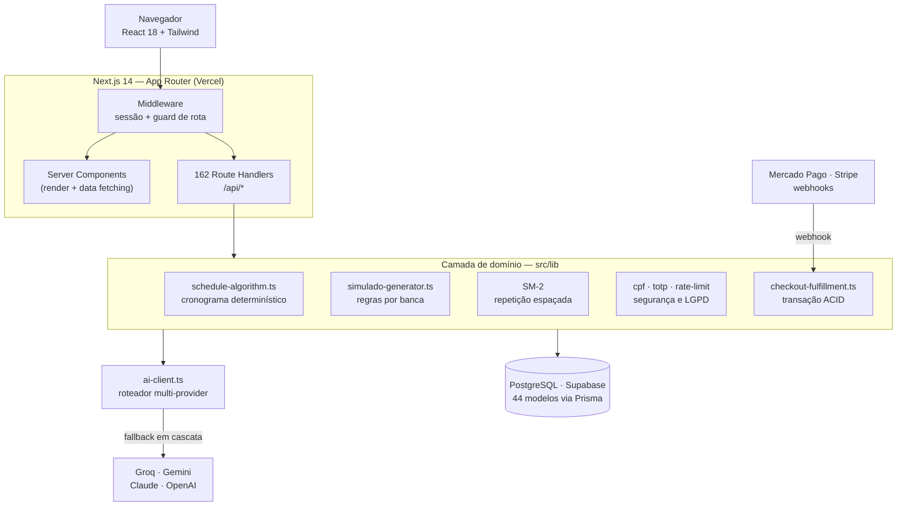

# GabaritAI

Plataforma SaaS de preparação para concursos públicos. Aplicação Next.js 14 fullstack em produção, com **162 endpoints de API**, banco PostgreSQL de **44 modelos** e orquestração de múltiplos provedores de LLM.

🔗 **Produção:** [gabaritai.app](https://gabaritai.app)

---

## O problema

Quem estuda para concurso de alta concorrência enfrenta três coisas que nenhuma planilha resolve: não saber **o que** estudar (editais com pesos diferentes por banca), não saber **quando revisar** (a curva do esquecimento não espera), e não ter **diagnóstico real** do próprio desempenho por matéria.

O GabaritAI ataca os três com algoritmos determinísticos — não com prompt de IA pedindo "monte um cronograma", que alucina datas e não tem rigor matemático.

---

## Arquitetura



**Por que Next.js App Router e não um backend separado?** O projeto chegou a ter um serviço NestJS (`apps/api`, ~1.9k linhas), mas o caminho de produção ficou nos Route Handlers do Next. Motivo prático: com um único deploy na Vercel, Server Components leem o banco direto sem round-trip HTTP, e as rotas `/api/*` cobrem o que precisa de contrato REST (webhooks, cron, cliente mobile futuro). Para um time de uma pessoa, a separação em dois deploys custava mais do que entregava.

---

## Decisões técnicas que valem explicação

### 1. Cronograma determinístico, não gerado por LLM

[`src/lib/schedule-algorithm.ts`](src/lib/schedule-algorithm.ts) · 303 linhas

LLM erra data, inventa carga horária e custa dinheiro a cada regeração. O algoritmo aqui é aritmética pura e **reprodutível** — mesma entrada, mesma saída, sempre:

1. Conta os dias entre hoje e a prova, filtrando só os dias da semana que o aluno marcou como disponíveis.
2. Multiplica por horas/dia → `totalMinAvailable`.
3. Calcula o necessário a partir dos pesos de cada matéria no edital → `totalMinRecommended`.
4. Distribui as matérias em **round-robin ponderado** pelo peso da banca, em blocos de 50 min, na proporção 65% teoria / 20% revisão / 15% questões.
5. Se `recomendado > disponível`, devolve `isFeasible: false` com o déficit em minutos — o aluno descobre **antes** que não vai dar tempo, e ajusta.

### 2. Repetição espaçada SM-2

[`src/app/api/me/flashcards/[id]/review/route.ts`](src/app/api/me/flashcards/[id]/review/route.ts)

O mesmo algoritmo do Anki. O aluno nota a resposta de 0 a 5 e o intervalo até a próxima revisão se ajusta pelo *ease factor*:

```
EF' = max(1.3, EF + (0.1 − (5−q) × (0.08 + (5−q) × 0.02)))
```

Nota < 3 reseta o intervalo para 1 dia. Nota ≥ 3 multiplica o intervalo anterior pelo EF.

Dois detalhes que não são óbvios:
- **IDOR.** O endpoint recebe um `id` na URL. Antes de qualquer escrita, ele confere se o flashcard pertence ao usuário autenticado ou é público. Sem essa checagem, trocar o id na URL deixaria qualquer aluno ler e sobrescrever o progresso de outro.
- **Concorrência.** `upsert` sobre a constraint composta `@@unique([userId, flashcardId])` — duas revisões simultâneas do mesmo card não criam registro duplicado.

### 3. Roteador de LLM com fallback em cascata

[`src/lib/ai-client.ts`](src/lib/ai-client.ts) · 230 linhas

Depender de um provedor só significa herdar o downtime e o rate limit dele. E usar um modelo caro para extrair texto de uma questão é desperdício. A fila muda conforme a natureza da tarefa:

| Tipo de tarefa | Ordem de tentativa |
|---|---|
| Extração mecânica | Groq → Gemini Flash → OpenAI → Claude |
| Geração de conteúdo | Gemini Flash → Claude → OpenAI → Groq |
| Correção de redação | Claude → OpenAI → Gemini → Groq |

Cada provedor que falha (erro, timeout, cota) cai para o próximo sem o usuário perceber.

Junto vem `parseAIJson`, que existe porque **modelo de linguagem não respeita contrato de saída**: às vezes devolve o JSON embrulhado em ```` ```json ````, às vezes precedido de "Claro! Aqui está:". A função limpa a marcação, e se o `JSON.parse` ainda falhar, extrai o primeiro `{...}` ou `[...]` por regex antes de desistir com erro rastreável.

### 4. Fulfillment de pagamento em transação atômica

[`src/lib/checkout-fulfillment.ts`](src/lib/checkout-fulfillment.ts) · 224 linhas

Quando o webhook do Mercado Pago confirma o pagamento, cinco escritas precisam acontecer **ou nenhuma**: atualizar o plano, matricular nos cursos, incrementar vendas, registrar o cupom e gravar auditoria. Tudo dentro de um `prisma.$transaction`.

Sem isso, um erro no meio produz o pior bug possível de um SaaS: **dinheiro cobrado, acesso não liberado.**

### 5. Dados pessoais sob LGPD

[`src/lib/cpf.ts`](src/lib/cpf.ts) · [`src/lib/totp.ts`](src/lib/totp.ts) · [`src/lib/rate-limit.ts`](src/lib/rate-limit.ts)

O CPF é gravado em **duas colunas com funções diferentes**, e a razão é que uma só não resolve:

- `cpfHash` — SHA-256 com salt. Determinístico, então aceita índice `@unique` e responde "esse CPF já existe?" em O(1). Irreversível.
- `cpfEncrypted` — AES-256-GCM, IV aleatório de 12 bytes, authentication tag. Reversível só sob necessidade fiscal. GCM e não CBC porque é autenticado: detecta adulteração do payload no banco, não só protege o sigilo.

Hash sozinho não permitiria devolver o dado ao titular; criptografia sozinha não permitiria checar unicidade sem decifrar a base inteira.

Também aqui: **2FA TOTP (RFC 6238)** implementado com o `crypto` nativo do Node — decode Base32, HMAC-SHA1 do contador de 8 bytes, truncamento dinâmico, módulo 10⁶, tolerância de ±1 janela para clock drift. E **rate limiting** em janela deslizante por `identifier:ip`: 5 tentativas em 15 min, lockout de 30 min, com trilha em `login_attempts` e `audit_logs`.

---

## Stack

| Camada | Tecnologia |
|---|---|
| Linguagem | TypeScript 5 |
| Framework | Next.js 14.2 (App Router), React 18 |
| Banco | PostgreSQL (Supabase) · Prisma 5 · 44 modelos |
| Auth | NextAuth · JWT via `jose` · cookies httpOnly · bcrypt · TOTP próprio |
| Validação | Zod · React Hook Form |
| Estado | Zustand · TanStack Query |
| UI | Tailwind · Framer Motion · Recharts · KaTeX |
| IA | Groq · Google Gemini · Anthropic Claude · OpenAI |
| Pagamento | Mercado Pago (PIX transparente) · Stripe |
| Deploy | Vercel |

---

## Rodando localmente

```bash
npm install
cp .env.example .env     # preencha as variáveis
npx prisma migrate dev
npx prisma db seed
npm run dev              # http://localhost:3000
```

Nenhum segredo é versionado. Todo `.env` está no `.gitignore`; o `.env.example` traz só os nomes das variáveis e valores de exemplo.

---

## O que ainda não existe

Sendo honesto sobre o estado do projeto:

- **Testes automatizados.** Zero. A validação hoje é manual e via Zod em runtime. É a próxima dívida a pagar — começando pelos algoritmos puros (`schedule-algorithm`, SM-2, `simulado-generator`), que são funções determinísticas e portanto o alvo mais fácil e mais útil para teste unitário.
- **CI/CD.** O deploy é o automático da Vercel. Não há pipeline rodando lint/typecheck/teste antes do merge.
- **Observabilidade.** Logs da Vercel apenas. Sem métricas, sem tracing, sem alerta.
- **Cache.** O Redis está previsto no desenho mas ainda não entrou — hoje todo rate limit e leitura quente vai direto ao Postgres.

---

## Estrutura

```
src/
├─ app/
│  ├─ api/            162 route handlers
│  │  ├─ admin/       68  gestão de conteúdo, cursos, usuários
│  │  ├─ me/          35  dados do próprio usuário (flashcards, progresso)
│  │  ├─ auth/        10  login, registro, OAuth, 2FA
│  │  ├─ simulados/    8  geração e correção
│  │  ├─ schedule/     7  cronograma
│  │  ├─ cron/         6  jobs agendados
│  │  └─ ai/           4  endpoints de IA
│  └─ (páginas do App Router)
├─ lib/               domínio: algoritmos, segurança, integrações
└─ components/        UI
```

---

*Projeto pessoal desenvolvido e mantido por João Lucas.*
