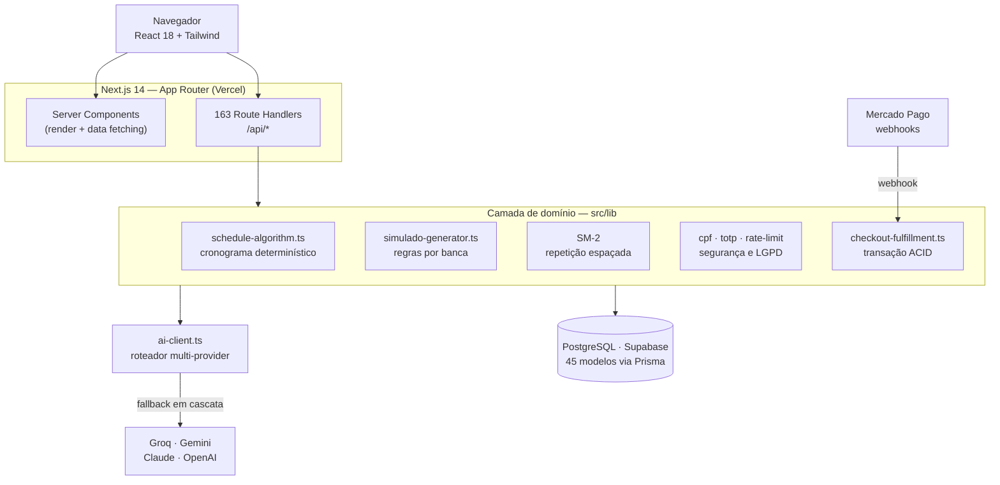
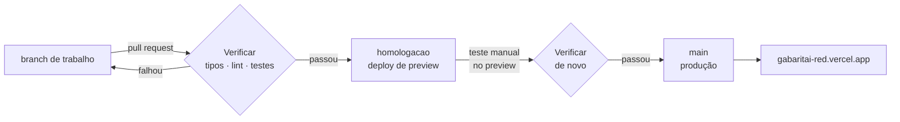

# GabaritAI

Plataforma SaaS de preparação para concursos públicos. Aplicação Next.js 14 fullstack em produção, com **163 endpoints de API**, banco PostgreSQL de **45 modelos** e orquestração de múltiplos provedores de LLM.

> ⚠️ **Preencher antes de publicar:** a URL de produção. O domínio `gabaritai.app`
> pertence a outra empresa — não usar.

---

## O problema

Quem estuda para concurso de alta concorrência enfrenta três coisas que nenhuma planilha resolve: não saber **o que** estudar (editais com pesos diferentes por banca), não saber **quando revisar** (a curva do esquecimento não espera), e não ter **diagnóstico real** do próprio desempenho por matéria.

O GabaritAI ataca os três com algoritmos determinísticos — não com prompt de IA pedindo "monte um cronograma", que alucina datas e não tem rigor matemático.

---

## Arquitetura



Não há `middleware.ts`: a sessão é verificada dentro de cada rota com `getUserFromRequest`/`verifyToken` (`src/lib/auth-server.ts`, `src/lib/jwt.ts`). É mais verboso que um middleware global, mas deixa explícito em cada endpoint quem pode chamá-lo.

**Por que Next.js App Router e não um backend separado?** O projeto chegou a ter um serviço NestJS (`apps/api`, ~1.9k linhas), mas o caminho de produção ficou nos Route Handlers do Next. Motivo prático: com um único deploy na Vercel, Server Components leem o banco direto sem round-trip HTTP, e as rotas `/api/*` cobrem o que precisa de contrato REST (webhooks, cron, cliente mobile futuro). Para um time de uma pessoa, a separação em dois deploys custava mais do que entregava.

---

## Decisões técnicas que valem explicação

### 1. Cronograma determinístico, não gerado por LLM

[`src/lib/schedule-algorithm.ts`](src/lib/schedule-algorithm.ts) · 303 linhas

LLM erra data, inventa carga horária e custa dinheiro a cada regeração. O algoritmo aqui é aritmética pura e **reprodutível** — mesma entrada, mesma saída, sempre:

1. Conta os dias entre hoje e a prova, filtrando só os dias da semana que o aluno marcou como disponíveis.
2. Multiplica por horas/dia → `totalMinAvailable`.
3. Calcula o necessário a partir dos pesos de cada matéria no edital → `totalMinRecommended`.
4. Distribui as matérias em **round-robin ponderado** pelo peso da banca, em blocos de 50 min, na proporção 65% teoria / 20% revisão / 15% questões.
5. Se `recomendado > disponível`, devolve `isFeasible: false` com o déficit em minutos — o aluno descobre **antes** que não vai dar tempo, e ajusta.

### 2. Repetição espaçada SM-2

[`src/app/api/me/flashcards/[id]/review/route.ts`](src/app/api/me/flashcards/[id]/review/route.ts)

O mesmo algoritmo do Anki. O aluno nota a resposta de 0 a 5 e o intervalo até a próxima revisão se ajusta pelo *ease factor*:

```
EF' = max(1.3, EF + (0.1 − (5−q) × (0.08 + (5−q) × 0.02)))
```

Nota < 3 reseta o intervalo para 1 dia. Nota ≥ 3 multiplica o intervalo anterior pelo EF.

Dois detalhes que não são óbvios:
- **IDOR.** O endpoint recebe um `id` na URL. Antes de qualquer escrita, ele confere se o flashcard pertence ao usuário autenticado ou é público. Sem essa checagem, trocar o id na URL deixaria qualquer aluno ler e sobrescrever o progresso de outro.
- **Concorrência.** `upsert` sobre a constraint composta `@@unique([userId, flashcardId])` — duas revisões simultâneas do mesmo card não criam registro duplicado.

### 3. Roteador de LLM com fallback em cascata

[`src/lib/ai-client.ts`](src/lib/ai-client.ts) · 230 linhas

Depender de um provedor só significa herdar o downtime e o rate limit dele. E usar um modelo caro para extrair texto de uma questão é desperdício. A fila muda conforme a natureza da tarefa:

| Tipo de tarefa | Ordem de tentativa |
|---|---|
| Extração mecânica | Groq → Gemini Flash → OpenAI → Claude |
| Geração de conteúdo | Gemini Flash → Claude → OpenAI → Groq |
| Correção de redação | Claude → OpenAI → Gemini → Groq |

Cada provedor que falha (erro, timeout, cota) cai para o próximo sem o usuário perceber.

Junto vem `parseAIJson`, que existe porque **modelo de linguagem não respeita contrato de saída**: às vezes devolve o JSON embrulhado em ```` ```json ````, às vezes precedido de "Claro! Aqui está:". A função limpa a marcação, e se o `JSON.parse` ainda falhar, extrai o primeiro `{...}` ou `[...]` por regex antes de desistir com erro rastreável.

### 4. Pagamento: três camadas de defesa contra o dinheiro sumir

[`src/lib/checkout-fulfillment.ts`](src/lib/checkout-fulfillment.ts) · [`src/lib/payment-sync.ts`](src/lib/payment-sync.ts) · [`src/lib/mercadopago.ts`](src/lib/mercadopago.ts)

O pior bug possível de um SaaS é **dinheiro cobrado, acesso não liberado** — e ele tem mais de uma causa. Cada uma pede uma defesa diferente.

**Atomicidade.** Quando o pagamento é confirmado, cinco escritas precisam acontecer ou nenhuma: atualizar o plano, matricular nos cursos, incrementar vendas, registrar o cupom e gravar auditoria. Tudo num `prisma.$transaction`. Um erro no meio não pode deixar o aluno pago e sem acesso.

**Idempotência, em dois níveis.** O Mercado Pago reenvia webhook — por retry, por timeout, por evento duplicado. O fulfillment só roda quando `paidAt` ainda está vazio, então a segunda notificação atualiza o registro e não libera nada de novo. No outro extremo do fluxo, uma cobrança PIX ainda pendente é reaproveitada em vez de gerar outra: sem isso, quem clica duas vezes enquanto o PIX compensa fica com dois QR Codes válidos e paga duas vezes. Uma camada evita **liberar** duas vezes; a outra evita **cobrar** duas vezes.

**Confirmação por push e por pull.** O webhook é o caminho normal, mas depende de o MP alcançar o servidor. A tela de PIX também consulta o pagamento direto na API a cada 4s e aplica o resultado pela mesma função do webhook ([`applyMpPaymentToLocal`](src/lib/payment-sync.ts)) — então a liberação não fica refém de uma entrega HTTP. Os dois caminhos convergem num código só, e não em duas implementações que divergem com o tempo.

**Status só anda pra frente.** O Mercado Pago manda várias notificações do mesmo pagamento, às vezes simultâneas, e cada uma consulta a API deles. Duas consultas paralelas podem voltar em ordem trocada — a que perguntou um instante antes da aprovação responde "pending" depois da que respondeu "approved", e sobrescreve. Isso aconteceu de verdade num pagamento real. A defesa não é ordenar as notificações (não há como), é tornar a escrita monotônica: [`transicaoPermitida`](src/lib/payment-status.ts) dá um nível a cada status e só aceita troca para nível igual ou maior. Notificação atrasada vira no-op; `APPROVED` só sai para `REFUNDED`.

Junto: validação HMAC-SHA256 da assinatura do webhook com janela anti-replay de 5 minutos, e checagem de valor divergente que rejeita o pagamento se o valor aprovado não bate com o cobrado.

Um detalhe de interface que também é correção de bug: `/api/checkout/status` devolve **por que** não confirmou (`sincronizado`, `erro_mp:…`, `sem_provider_payment_id`), em vez de só devolver que não confirmou. Antes, uma falha de rede e um PIX legitimamente pendente apareciam idênticos para o usuário — um erro disfarçado de estado normal é um erro que ninguém reporta.

### 5. Dados pessoais sob LGPD

[`src/lib/cpf.ts`](src/lib/cpf.ts) · [`src/lib/totp.ts`](src/lib/totp.ts) · [`src/lib/rate-limit.ts`](src/lib/rate-limit.ts)

O CPF é gravado em **duas colunas com funções diferentes**, e a razão é que uma só não resolve:

- `cpfHash` — SHA-256 com salt. Determinístico, então aceita índice `@unique` e responde "esse CPF já existe?" em O(1). Irreversível.
- `cpfEncrypted` — AES-256-GCM, IV aleatório de 12 bytes, authentication tag. Reversível só sob necessidade fiscal. GCM e não CBC porque é autenticado: detecta adulteração do payload no banco, não só protege o sigilo.

Hash sozinho não permitiria devolver o dado ao titular; criptografia sozinha não permitiria checar unicidade sem decifrar a base inteira.

Também aqui: **2FA TOTP (RFC 6238)** implementado com o `crypto` nativo do Node — decode Base32, HMAC-SHA1 do contador de 8 bytes, truncamento dinâmico, módulo 10⁶, tolerância de ±1 janela para clock drift. E **rate limiting** em janela deslizante por `identifier:ip`: 5 tentativas em 15 min, lockout de 30 min, com trilha em `login_attempts` e `audit_logs`.

### 6. Segredo ausente é erro, nunca valor padrão

[`src/lib/segredo.ts`](src/lib/segredo.ts) · [`src/lib/cron-auth.ts`](src/lib/cron-auth.ts) · [`src/lib/setup-auth.ts`](src/lib/setup-auth.ts)

O padrão `process.env.CHAVE ?? 'valor-de-desenvolvimento'` é comum e, num repositório público, perigoso: se a variável faltar em algum ambiente, o sistema não quebra — passa a operar com uma chave que qualquer pessoa lê no GitHub. Uma auditoria procurando essa classe de bug achou o padrão na chave de criptografia de CPF, nos salts de hash e no token dos crons.

A regra agora é uma só: fora de produção o fallback existe (para `next dev` funcionar sem configuração); em build de produção, incluindo previews, segredo ausente é erro explícito. Comparações de token usam `timingSafeEqual` sobre SHA-256, para não vazar o segredo pelo tempo de resposta.

Mesma auditoria, outro achado: o `/api/health` público fazia uma chamada real a cada provedor de IA por acesso. Abrir em loop esgotava a cota gratuita que atende os alunos. Hoje a versão pública só responde `{ ok, versao }` — o commit no ar — e o diagnóstico completo exige admin, com cache de 5 minutos.

---

## Stack

| Camada | Tecnologia |
|---|---|
| Linguagem | TypeScript 5 |
| Framework | Next.js 14.2 (App Router), React 18 |
| Banco | PostgreSQL (Supabase) · Prisma 5 · 45 modelos |
| Auth | JWT próprio via `jose` · cookies httpOnly · bcrypt · TOTP próprio · Google OAuth 2.0 |
| Validação | Zod · React Hook Form |
| Estado | Zustand · TanStack Query |
| UI | Tailwind · Framer Motion · Recharts · KaTeX |
| IA | Groq · Google Gemini · Anthropic Claude · OpenAI |
| Pagamento | Mercado Pago (PIX transparente, Checkout Pro) |
| Deploy | Vercel |

---

## Rodando localmente

```bash
npm install
cp .env.example .env     # preencha as variáveis
npx prisma migrate dev
npx prisma db seed
npm run dev              # http://localhost:3000
```

Nenhum segredo é versionado. Todo `.env` está no `.gitignore`; o `.env.example` traz só os nomes das variáveis e valores de exemplo.

---

## Ambientes e promoção

Mudança nenhuma vai direto para quem está pagando. O caminho é sempre o mesmo, e cada etapa só existe porque a anterior pode deixar passar algo:



| Etapa | O que roda | O que pega |
|---|---|---|
| Pull request | [`.github/workflows/verificar.yml`](.github/workflows/verificar.yml) — `typecheck`, `lint`, `test` | Erro de tipo, regressão nas funções puras |
| `homologacao` | Deploy de preview da Vercel, URL própria | Erro que só aparece com build real e banco |
| `main` | Deploy de produção | — |

As checagens rodam de novo na promoção para `main`, porque entre o teste no preview e o merge o `main` pode ter andado.

O build **não** roda no CI de propósito: ele exige `DATABASE_URL` e as chaves de API, e segredo de produção em runner de CI é risco sem retorno. A Vercel já builda cada branch e falha lá.

**Reprodutibilidade.** O `package-lock.json` é versionado. Sem ele, dois deploys do mesmo commit podem instalar versões diferentes e produzir sites diferentes — falha que não aparece em nenhum diff.

---

## O que ainda não existe

Sendo honesto sobre o estado do projeto:

- **Cobertura de teste.** 24 testes, sobre três módulos puros e críticos: leitura da notificação do Mercado Pago, validação da assinatura do webhook e bloqueio de open redirect. Os algoritmos de domínio (`schedule-algorithm`, SM-2, `simulado-generator`) ainda não têm — são o próximo alvo, por serem determinísticos e portanto baratos de testar.
- **Testes de integração.** Nenhum. O que existe roda sem banco e sem rede; o caminho completo de checkout é verificado à mão.
- **Separação de banco por ambiente.** O preview de `homologacao` ainda aponta para o mesmo Postgres da produção. Enquanto for assim, homologação testa o código, não os dados — um `DATABASE_URL` próprio no ambiente de Preview da Vercel resolve.
- **Observabilidade.** Logs da Vercel apenas. Sem métricas, sem tracing, sem alerta.
- **Cache.** O Redis está previsto no desenho mas ainda não entrou — hoje todo rate limit e leitura quente vai direto ao Postgres. O rate limit é um `Map` em memória, então na prática limita por instância, não globalmente.

---

## Estrutura

```
src/
├─ app/
│  ├─ api/            163 route handlers
│  │  ├─ admin/       68  gestão de conteúdo, cursos, usuários
│  │  ├─ me/          35  dados do próprio usuário (flashcards, progresso)
│  │  ├─ auth/        10  login, registro, OAuth, 2FA
│  │  ├─ simulados/    8  geração e correção
│  │  ├─ schedule/     7  cronograma
│  │  ├─ cron/         6  jobs agendados
│  │  └─ ai/           4  endpoints de IA
│  └─ (páginas do App Router)
├─ lib/               domínio: algoritmos, segurança, integrações
└─ components/        UI
```

---

*Projeto pessoal desenvolvido e mantido por João Lucas.*
